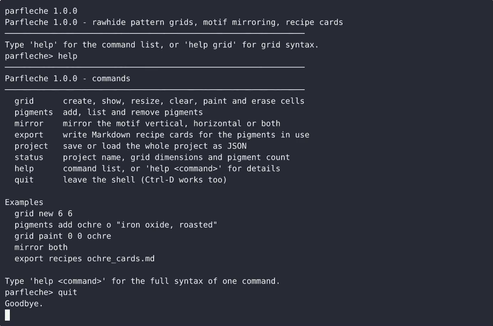
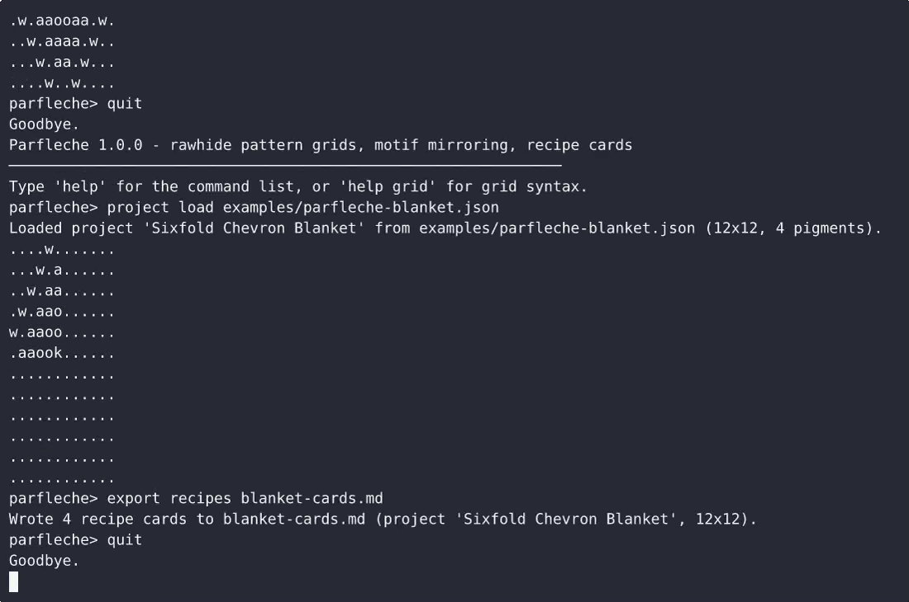

# Parfleche — complete Full-stack app recipe command-line tool example app

Most open-source command-line tool projects ship a skeleton. **Parfleche** ships the whole thing: production-ready Full-stack app source, seeded demo data, and a Parfleche install script that runs in minutes. Parfleche is a single-file, standard-library-only Python CLI for building rawhide pattern grids, mirroring motifs across horizontal and vertical axes, and exporting pigment recipe cards as Markdown. Apache-2.0-licensed — [remix Parfleche on cenius.ai](https://cenius.ai/marketplace/p/parfleche?ref=gh&utm_campaign=parfleche-webapp) for your own branded build.


[](LICENSE)  [](https://cenius.ai)

[](https://cenius.ai/marketplace/p/parfleche?ref=gh&utm_campaign=parfleche-webapp)

> **▶ [Open & edit in cenius.ai](https://cenius.ai/marketplace/p/parfleche?ref=gh&utm_campaign=parfleche-webapp)** — one click to an editable workspace: describe changes in plain English, get an instant preview, one-click deploy and host. Modifications made on the platform come with full rebrand & relicense rights.

_Local clone? See [Quick start](#quick-start) below. cenius.ai is the zero-setup path._

## Demo


▶ **[See it in action](https://cenius.ai/marketplace/p/parfleche?ref=gh&utm_campaign=parfleche-webapp)** — full demo on the project page · [MP4](.github/media/demo.mp4)

## Screenshots

 

## Quick start

```bash
./install.sh   # installs dependencies + seeds demo data
```

See [`INSTALL.md`](INSTALL.md) for full setup and usage instructions.

## Usage guide

Everything happens inside the `parfleche>` shell. Type `help` for the command
list, `help <command>` for full syntax plus examples, and `quit` (or Ctrl-D) to
leave. Arguments with spaces go in double quotes.

Cells are addressed as `<x> <y>`, zero-indexed, with `0 0` at the top-left corner.

### 1. Build a grid and paint it

```
parfleche> grid new 6 6
Created an empty 6x6 grid for project 'Untitled'. The cell grid is below; paint it with 'grid paint <x> <y> <pigment>'.
......
......
......
......
......
......
parfleche> pigments add ochre o "iron oxide, roasted to a red-brown"
Added pigment 'ochre' with symbol 'o'.
parfleche> grid paint 2 1 ochre
Painted 'ochre' at (2,1) as 'o'.
......
..o...
......
......
......
......
```

- `grid resize <w> <h>` keeps the overlapping cells in the top-left corner and
  clears anything that falls outside. It tells you how many painted cells it lost.
- `grid clear` empties every cell and reports how many it cleared.
- `grid erase <x> <y>` empties one cell ("was already empty" when nothing was there).
- `grid new <w> <h>` starts a fresh empty canvas **and keeps the pigment library**
  and project name, so you do not have to re-enter four recipes to change canvas size.

### 2. Mirror the motif

```
parfleche> grid paint 0 0 ochre
parfleche> mirror vertical
Mirrored vertically (left half onto the right): 1 cell changed.
o....o
......
......
......
......
......
```

_Full guide: [`USAGE.md`](USAGE.md)_

## Features

- Rawhide pattern grid builder
- Symmetric motif mirror tool
- Pigment recipe card export
- Save/load JSON project file
- Pigment library management
- Interactive command shell
- Input validation and error resilience

## Architecture

No external services required: the entire recipe command-line tool runs from this Full-stack app repo (22 files). Top-level layout: `examples/`, `tests/`. Run `./install.sh` once to install packages and populate demo data — the app is ready to use immediately after. Step-by-step setup guide: [`INSTALL.md`](INSTALL.md).

## FAQ

### Can I deploy Parfleche on my own infrastructure?

Grab the repo and run `./install.sh` — it handles packages and seed data in one go. After that, [`INSTALL.md`](INSTALL.md) walks you through starting the server. No external accounts required.

### Can I use Parfleche in a commercial project?

The code is under the Apache-2.0 license, which allows commercial use without restriction. You can build, sell, and deploy it freely. Full text: [LICENSE](LICENSE).

### Is it possible to white-label Parfleche for a client?

Yes — and the easiest way is [remixing it on cenius.ai](https://cenius.ai/marketplace/p/parfleche?ref=gh&utm_campaign=parfleche-webapp): modifications made on the platform come with full rebrand and relicense rights over your derivative.

### Can non-developers customise Parfleche?

Describe what you want changed on [cenius.ai](https://cenius.ai/marketplace/p/parfleche?ref=gh&utm_campaign=parfleche-webapp) — no code editing needed; the platform produces a fresh build you can download and deploy.

### What is Parfleche built with?

Full-stack app end-to-end. Every file you need to run the app is here in this repository — code, configuration, seed data. Highlights include symmetric motif mirror tool.

## License & rebranding

Released under the [Apache License 2.0](LICENSE) (© 2026 Cenius AI) — free for personal and commercial use. The Cenius name/logo are trademarks (see NOTICE).

**Need a customized version?** [Remix this app on cenius.ai](https://cenius.ai/marketplace/p/parfleche?ref=gh&utm_campaign=parfleche-webapp) — modifications made on the platform come with **full rebrand & relicense rights** over your derivative.

## Built with cenius.ai

This entire application — code, design, seeded demo data — was generated on **[cenius.ai](https://cenius.ai)** from a plain-English description.

- 🚀 [Build your own app on cenius.ai](https://cenius.ai)
- 🎛️ [Remix Parfleche on the marketplace](https://cenius.ai/marketplace/p/parfleche?ref=gh&utm_campaign=parfleche-webapp) — open it in a workspace, prompt for changes, and ship your own version.

More open-source apps: [the Cenius-ai catalog](https://github.com/Cenius-ai) · [showcase index](https://github.com/Cenius-ai/showcase)
